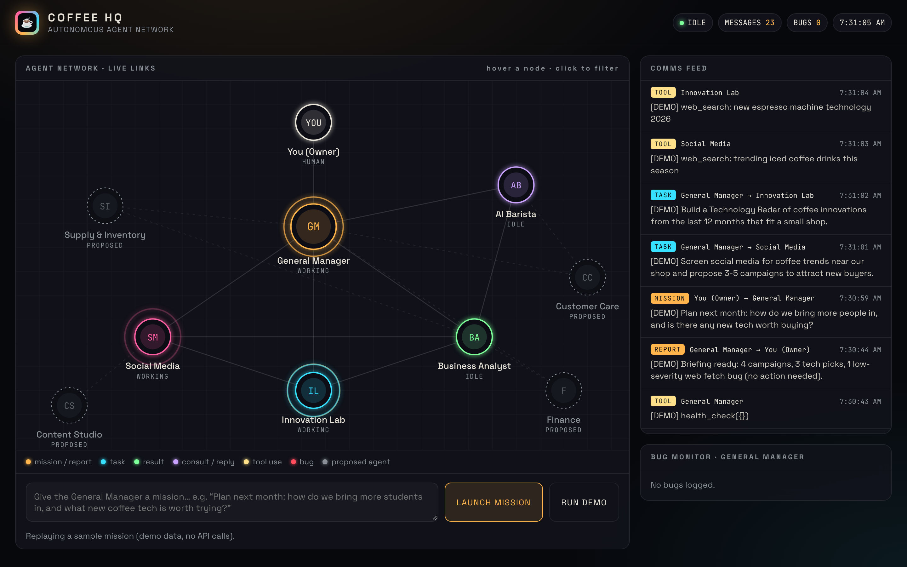

# Coffee AI

AI agents for a coffee business, built on Claude.

## Coffee HQ: multi-agent platform



A **General Manager** agent runs a team of agents. It delegates and monitors bugs. **Social Media** proposes ways to
attract buyers, and **Innovation Lab** scouts new coffee tech. The agents talk to each other over a
message bus, and the dashboard draws every message live.

```bash
python hq.py serve                 # dashboard at http://127.0.0.1:8765
python hq.py demo                  # sample mission, no API key needed
python hq.py mission "Plan next month: more students, and any new tech worth buying?"
python hq.py health                # health and bug summary
python -m unittest                 # offline tests
```

See [docs/ARCHITECTURE.md](docs/ARCHITECTURE.md) for how agents communicate, bug monitoring,
and suggested agents to add next.

## Chat assistants

It has two modes:

- **Customer mode**: an AI barista that answers menu and opening-hours questions,
  recommends drinks, and takes pickup orders (saved to `data/orders.json`).
- **Owner mode** (the Business Analyst agent): a business helper that writes social posts, promotions and
  newsletters, suggests menu and pricing ideas, and summarizes sales.

## Setup

```bash
pip install -r requirements.txt
export ANTHROPIC_API_KEY=sk-ant-...   # from https://console.anthropic.com
```

## Run

```bash
python main.py            # customer assistant
python main.py --owner    # owner assistant
```

## Make it yours

Edit `data/business.json`: shop name, address, hours, menu items, prices,
milk and size upcharges, and policies. The assistant reads it on start, so it
never makes up prices or hours.

## How it works

- `coffee_ai/tools.py`: functions the AI can call (`get_menu`, `get_store_info`,
  `place_order`, `get_order_status`, `sales_summary`). Add a function with the
  `@beta_tool` decorator and put it in `CUSTOMER_TOOLS` or `OWNER_TOOLS` to give
  the AI a new ability.
- `coffee_ai/hq/`: the agent platform (`base.py` loop, `agents.py`, `bus.py`, `monitor.py`, dashboard).
- `main.py`: a terminal chat with the Barista or the Analyst.

## Ideas for next steps

- Put the agent behind a web chat widget, WhatsApp or Instagram DMs.
- Connect `place_order` to your POS (Square, Toast, Shopify) instead of a JSON file.
- Add a loyalty-points tool or an inventory tool that warns when beans run low.
