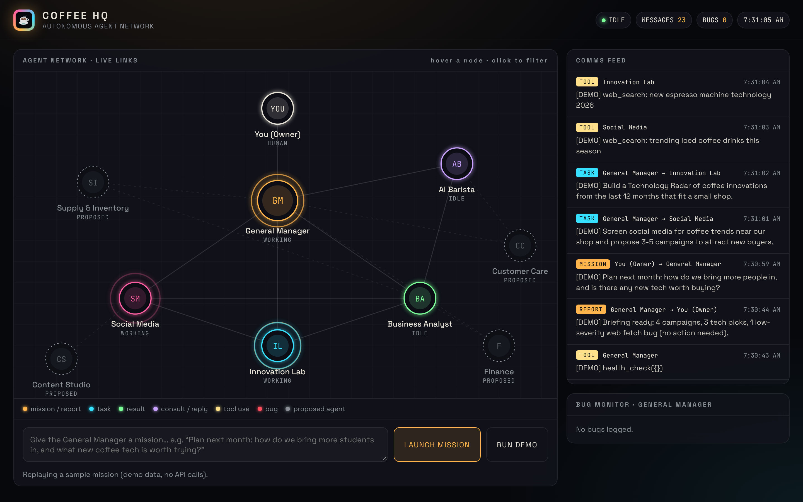

# Coffee HQ: architecture



## The network

```
                         You (Owner)
                              │  mission ▼   ▲ report
                     ┌────────┴────────┐
          ┌─────────►│ GENERAL MANAGER │◄──────── bug alerts from every agent
          │          └──┬─────┬─────┬──┘
          │       task  │     │     │  task                       ┌──────────────┐
          │      ┌──────┘     │     └───────┐          monitors   │  AI Barista  │◄── customers
          │      ▼            ▼             ▼          ──────────►│ (main.py)    │
          │ ┌─────────┐  ┌──────────┐  ┌──────────┐               └──────┬───────┘
          │ │ Social  │◄►│Innovation│◄►│ Business │◄── orders data ──────┘
          │ │ Media   │  │   Lab    │  │ Analyst  │
          │ └────┬────┘  └────┬─────┘  └──────────┘
          │      └─consult────┴──────────────►▲
          └──────────── result ───────────────┘
```

| Agent | Job | Tools |
|---|---|---|
| **General Manager** (`gm`) | Plans each mission, delegates, checks results, writes the briefing, watches bugs and health | `delegate`, `bug_report`, `health_check` |
| **Social Media** (`social`) | Screens public social trends, proposes campaigns with ready-to-post captions | web search, web fetch, `consult` |
| **Innovation Lab** (`innovation`) | Builds a Technology Radar (ADOPT / TRIAL / WATCH) of new coffee tech | web search, web fetch, `consult` |
| **Business Analyst** (`analyst`) | Real menu, price and sales numbers; owner chat mode | `get_menu`, `get_store_info`, `sales_summary` |
| **AI Barista** (`barista`) | Customer chat and pickup orders | `get_menu`, `get_store_info`, `place_order`, `get_order_status` |

## How agents communicate

Every message goes through the **message bus** (`coffee_ai/hq/bus.py`) and is logged in
`data/hq_events.jsonl`. The dashboard draws each one as a pulse travelling along a link.

| Kind | Route | Meaning |
|---|---|---|
| `mission` | owner → gm | A goal you give the platform |
| `task` / `result` | gm ↔ specialist | Delegated work and its answer |
| `consult` / `reply` | specialist ↔ specialist | Peers asking each other (e.g. Social asks Analyst which drink has the best margin) |
| `tool` | agent | Web search, data lookup |
| `bug` | agent → gm | Something went wrong |
| `report` | gm → owner | Final briefing (also saved in `data/reports/`) |

Guard rails:
- An agent can only consult the peers it is linked to, and only one level deep, so agents cannot loop forever.
- Each agent stops after 12 steps.
- Social Media and Innovation only **propose**. Nothing is posted or bought without you.
- Social Media looks at public trends and audience groups. It never profiles private individuals.

## Bug monitoring

`coffee_ai/hq/monitor.py` catches, logs (`data/bugs.jsonl`) and sends to the GM:

| Kind | When |
|---|---|
| `crash`, `api_error` | Exception or API failure |
| `tool_error` | A tool raised an error or an unknown tool was called |
| `web_tool_error` | A web search or fetch failed |
| `refusal` | The model declined (a fallback model is tried first) |
| `max_tokens`, `step_limit` | Answer cut off, or the agent ran out of steps |

The GM checks `bug_report` and `health_check` on every mission and puts a **System health** section in its briefing.

## Proposed next agents

These show as dashed nodes on the dashboard. Each is a small class in `agents.py`.

| Agent | Why |
|---|---|
| **Supply & Inventory** | Tracks bean and milk stock, compares supplier prices, drafts reorders before you run out |
| **Customer Care** | Reads Google and Yelp reviews and DMs, drafts replies, spots complaints early. Links to the Barista |
| **Finance** | Cost per cup, margins, cash flow, "what if we raise latte prices by 25¢" |
| **Content Studio** | Turns Social's proposals into images, reel scripts and a posting calendar |

## Proposed next structure

1. **Approval inbox**: every proposed action (post, purchase, price change) waits for your one-click yes.
2. **Scheduled missions**: e.g. Monday 7am "weekly briefing", daily social scan. Run `python hq.py mission ...` from cron.
3. **Shared memory**: a knowledge base of past missions and outcomes, so agents learn what worked.
4. **Real connections**: Instagram/TikTok business APIs for Social, your POS (Square, Toast) for orders and sales.
5. **Cost guard**: a monthly API budget the GM tracks, with cheaper settings for routine jobs.

## Adding an agent

```python
class SupplyAgent(Specialist):
    name, title = "supply", "Supply & Inventory Agent"
    role = "Tracks stock and drafts reorders."
    peers = ("analyst",)
    def system_prompt(self): return "..."
```

Add it to `LIVE_AGENTS`, set `"status": "live"` in `NODES`, and add `"supply"` to the GM's
`delegate` list.
